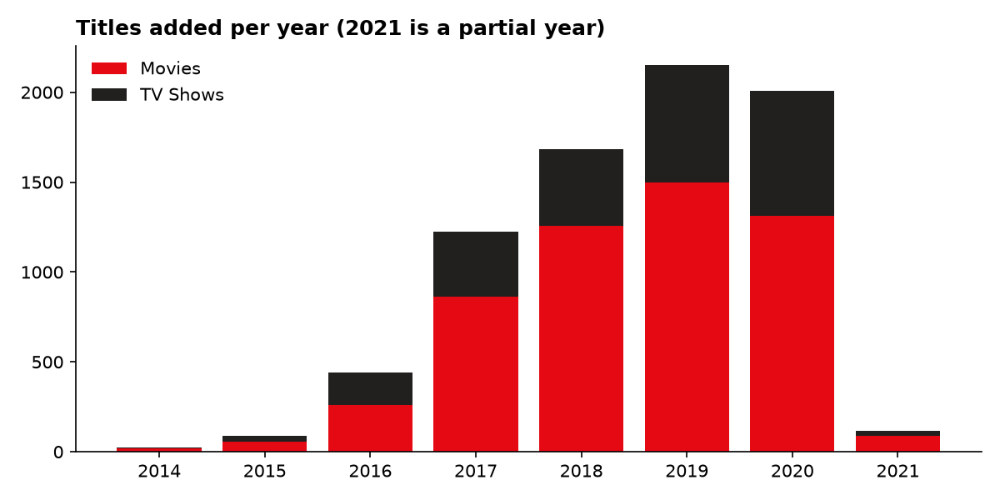
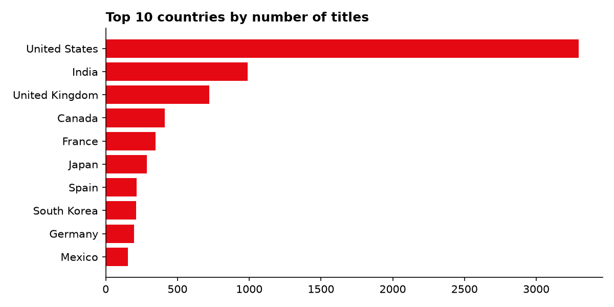
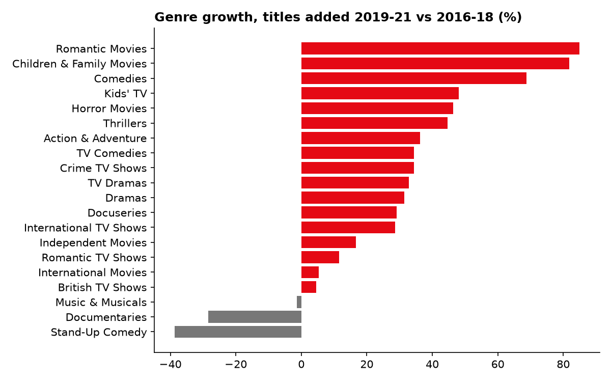

# Streaming Content Analysis (SQL)

SQL analysis of the Netflix catalogue: 7,787 movies and TV shows, run on SQLite. The pipeline cleans messy text columns, splits multi-value fields (genres, countries, directors), and answers 17 business questions with window functions and CTEs.

## Key findings
- **The catalogue is about 69% movies and 31% TV shows**, and that ratio has stayed fairly steady since 2017.
- **Additions grew quickly until 2019.** Titles added per year went from 443 in 2016 to 2,153 in 2019, then dipped slightly in 2020 (2,009). The 2021 figure covers only part of the year, so it can't be compared.
- **The US makes up 45% of titles, India 14% and the UK 10%.** India is the clear number two, with 990 titles.
- **International Movies (2,437) and Dramas (2,106) are the biggest movie genres.** For TV, International TV Shows (1,199) and TV Dramas (704) lead.
- **Romantic Movies (+85%) and Children & Family Movies (+82%) grew fastest** between 2016-18 and 2019-21 among genres with 100+ early titles. Documentaries (-28%) and Stand-Up Comedy (-39%) shrank.
- **Most TV shows are short:** 67% have a single season, and under 1% run to 10 or more.
- **Content is getting older when it arrives.** The average title was 3.0 years old when added in 2016 and 5.3 years old in 2019.
- **The most prolific directors are stand-up specialists.** Jan Suter has 21 titles, then Raúl Campos (19) and Marcus Raboy (16).
- **Data quality:** 31% of titles have no director, 9% no cast and 6.5% no country, so director analysis covers only about two-thirds of the catalogue.





All 17 result tables are in [results/REPORT.md](results/REPORT.md), with one CSV per query in `results/`.

## Run it
```
python run_project.py     # builds streaming.db, runs the SQL, exports results/
python make_charts.py     # optional: redraws charts (needs matplotlib)
```
`run_project.py` needs only Python 3.8+. Open `streaming.db` in DB Browser for SQLite or the VS Code SQLite extension to explore it.

## Data
`data/netflix_titles.csv` is the public "Netflix Movies and TV Shows" dataset, taken from the [TidyTuesday 2021-04-20 release](https://github.com/rfordatascience/tidytuesday/tree/master/data/2021/2021-04-20). It originates from Kaggle ([shivamb/netflix-shows](https://www.kaggle.com/datasets/shivamb/netflix-shows)) and was scraped from Flixable. Check the Kaggle page for licence terms. The data runs to roughly mid-2021, and it is a snapshot of one catalogue, not of Netflix's full history.

`data/synthetic/` holds a generator for fake data with the same columns. It was only used while building the project and isn't used in the analysis.

## Pipeline
| File | Purpose |
|---|---|
| `sql/01_clean.sql` | Trim text, turn blanks into NULL, parse `'September 25, 2021'` into an ISO date, split `duration` into minutes or seasons, and remove duplicates with `ROW_NUMBER()` |
| `sql/02_split.sql` | A recursive CTE splits comma-separated `listed_in`, `country` and `director` into bridge tables (`title_genres`, `title_countries`, `title_directors`) |
| `sql/03_analysis.sql` | 17 analysis queries |

## SQL skills shown
- **String handling:** `TRIM`, `NULLIF`, `substr`, `instr`, `printf`, `lower`
- **Splitting genres and countries:** recursive CTEs, and `DISTINCT` to stop co-productions being counted twice
- **Trends over time:** `LAG` for year-over-year change, running totals, moving averages, period-over-period genre growth, seasonality
- **Rankings:** `RANK`, `DENSE_RANK`, `ROW_NUMBER() OVER (PARTITION BY ...)` for top-N per group
- **Other:** self-join genre pairs, share-of-total with `SUM() OVER ()`, and a data-quality audit

## Caveats
- Co-productions count toward every country listed, so country percentages add up to more than 100%. The same applies to genres.
- Year-over-year change for 2021 and early years is distorted by partial or tiny counts.
- `date_added` shows when a title was added to Netflix, not when it was released.

## Porting to other databases
The queries are standard SQL apart from a few SQLite functions. For Postgres or SQL Server, replace the recursive splitter with `unnest(string_to_array())` or `STRING_SPLIT`, and swap `printf` and `instr` for `to_date` and `position` (or `CHARINDEX`).
